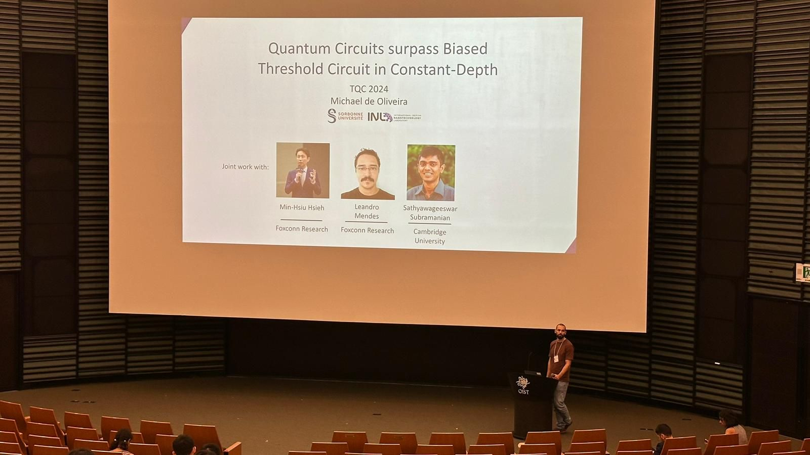
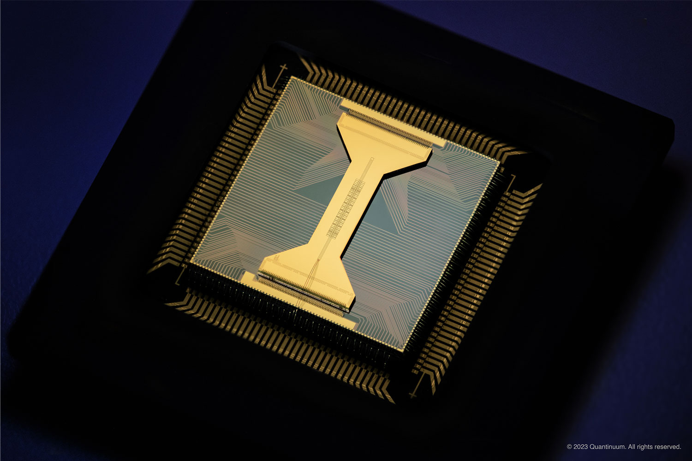
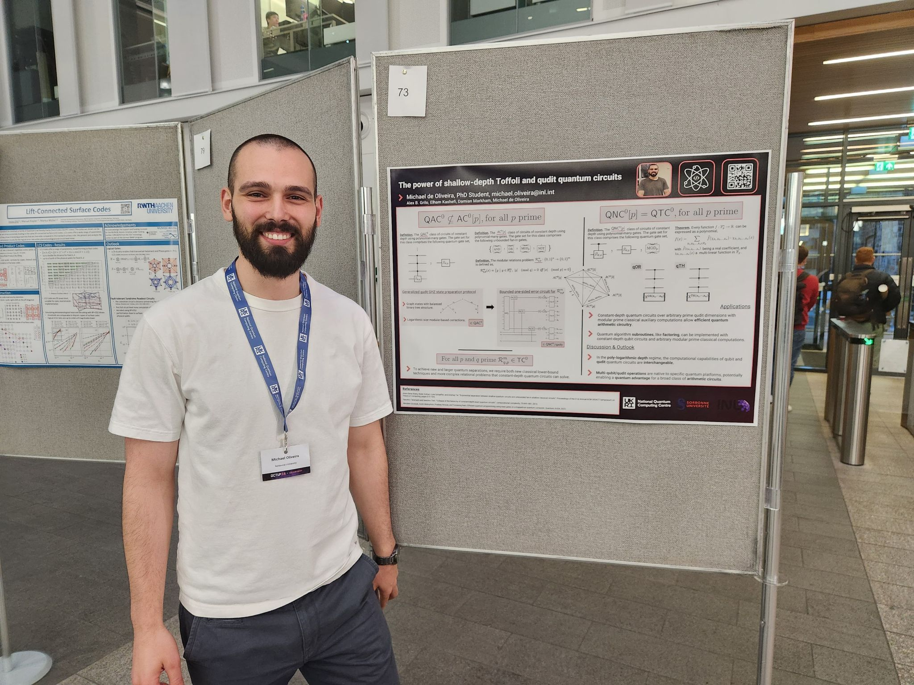
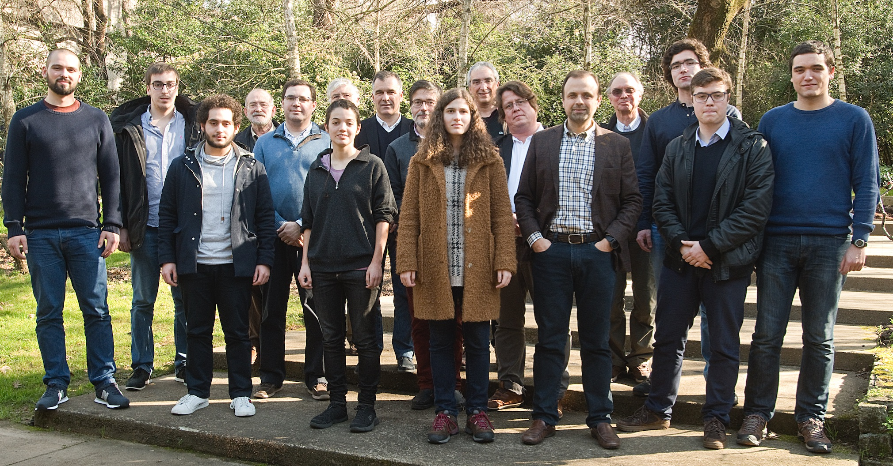
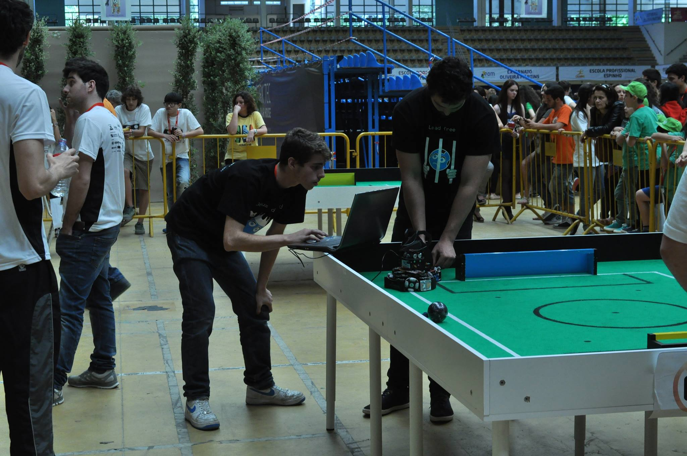
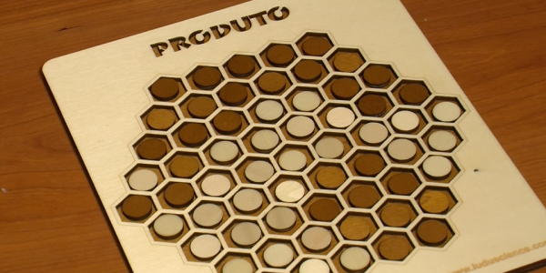

<!-- Google tag (gtag.js) -->

<!-- Load font + custom alignment styles -->
<link href="https://fonts.googleapis.com/css2?family=Playfair+Display:wght@700&display=swap" rel="stylesheet">

  <h1 class="name-title">Michael de Oliveira</h1>

  

    <!-- PHOTO -->
    <figure class="intro-photo">
      
    </figure>

    <!-- TEXT -->
    

    <h2 style="margin-top:0;">About me</h2>
      

    I am a Research Scientist in the Quantum Computing team at <a href="https://www.honhai.com/en-us/rd-and-technology/institute" target="_blank" rel="noopener noreferrer">Foxconn's Research Center</a>, led by <a href="https://www.minhsiu.com/" target="_blank" rel="noopener noreferrer">Min-Hsiu Hsieh</a>, where I work on quantum algorithms and quantum complexity theory. Previously, I completed my Ph.D. jointly at the <a href="https://inl.int/" target="_blank" rel="noopener noreferrer">International Iberian Nanotechnology Laboratory (INL)</a> and Sorbonne University, under the supervision of <a href="https://en.wikipedia.org/wiki/Elham_Kashefi" target="_blank" rel="noopener noreferrer">Elham Kashefi</a>, <a href="https://sites.google.com/view/efgalvao" target="_blank" rel="noopener noreferrer">Ernesto Galvão</a>, and <a href="https://www.di.uminho.pt/~lsb/" target="_blank" rel="noopener noreferrer">Luis Soares Barbosa</a>. I also spent time as a research intern at <a href="https://research.ibm.com/labs/cambridge" target="_blank" rel="noopener noreferrer">IBM Quantum</a>, working with <a href="https://agheorghiu.com/" target="_blank" rel="noopener noreferrer">Alexandru Gheorghiu</a>.
      

    

  

  <section class="research-interests">
    <h2 style="margin-top:2rem;">Research Interests</h2>
      

        My research interests broadly lie in quantum technologies, with a particular focus on understanding the fundamental differences between quantum and classical computation and processes.
      

    <h4 style="margin-top:0;">Core Areas of Interest:</h4>
      <ul>
        <li>Quantum algorithms</li>
        <li>Quantum compilation and circuit complexity</li>
        <li>Learning theory</li>
      </ul>
      

        I am always happy to discuss ideas and explore potential collaborations with others interested in these topics. I also welcome inquiries from prospective research interns.
      

  </section>

<section id="timeline" style="scroll-margin-top:4rem; margin-top:4rem;">
<h1 style="text-align:left; margin:0 0 2rem;"> So Far …</h1>

<h3>PhD Thesis Defense</h3>

🎓 I successfully defended my PhD thesis titled “The Interplay between Quantum Foundations and Circuit Complexity.” The defense took place before a jury including external examiners <a href="https://www.linkedin.com/in/dan-browne-658303146/" rel="noopener noreferrer" target="_blank">Dan Browne</a> and Daniel Grier, as well as internal members <a href="https://www.linkedin.com/in/luis-santos-ab5a62a/" rel="noopener noreferrer" target="_blank">Luis Santos</a> and <a href="https://www.linkedin.com/in/josepproenca/" rel="noopener noreferrer" target="_blank">José Proença</a>.

🔑💡My thesis examines how non-local games, formal frameworks that capture non-classical correlations, can be directly linked to computational advantages in shallow quantum circuits. It establishes explicit correspondences between optimal quantum strategies for these games and efficient quantum circuit constructions, and also proposes new methods for benchmarking quantum devices, providing circuit-level characterizations.

<figure style="margin:1rem 0; padding-bottom:1rem;">

</figure>

<h3>
    Quantum Computing Theory Research Scientist Intern
  </h3>

      As an intern at IBM Quantum in the <a href="https://mitibmwatsonailab.mit.edu/" rel="noopener noreferrer" target="_blank">
    MIT–IBM Watson AI Lab
  </a>, I worked on developing new quantum algorithms in learning theory, a subfield of computer science that studies the theoretical foundations of machine learning. Our team designed quantum algorithms capable of efficiently learning the underlying Boolean functions that label quantum data examples. The key innovation was a quantum method that can learn significantly more complex labeling functions than previously possible, resolving a problem that had remained open for decades in computational learning theory.
   <figure style="margin-top:1rem; text-align:center;">

</figure>
<strong>Read more:</strong>
<a href="https://www.arxiv.org/abs/2509.14461" rel="noopener noreferrer" target="_blank">Research Paper</a>

<h3>
    Associate Researcher
  </h3>

As an Associate Researcher at Foxconn in the <a href=" https://www.honhai.com/en-us/rd-and-technology/institute" rel="noopener noreferrer" target="_blank">
   Hon Hai Quantum Computing Research Center
  </a>, I have focused on quantum computational circuit complexity, particularly on identifying computational problems that demonstrate a provable quantum advantage over classical computation. Our team showed that parallel quantum computing models can provably outperform biased threshold circuits — a parallel classical computing model that captures key aspects of feedforward neural networks. This work established the largest known separation between classical and quantum computational power of this type. We further extended the result to qudit-based architectures, broadening its applicability across a wider range of quantum systems. Finally, we demonstrated that this quantum advantage is robust to noise, indicating that it is practically realizable with near-term quantum technologies.
    
<figure style="margin-top:1rem; text-align:center;">

</figure>
<strong>Read more:</strong>
<a href="https://www.nature.com/articles/s41467-025-58545-4" rel="noopener noreferrer" target="_blank">Research Paper (in Nature Communications)</a> ·
  <a href="https://tw.news.yahoo.com/%E6%B7%B1%E5%A4%9C%E4%BE%86%E9%BB%9E%E9%87%8F%E5%AD%90%E5%8A%9B%E5%AD%B8-%E9%B4%BB%E6%B5%B7%E9%A9%9A%E4%BA%BA%E7%A0%94%E7%A9%B6%E7%99%BB%E4%B8%8A%E5%9C%8B%E9%9A%9B%E6%9C%9F%E5%88%8A-%E7%9C%8B%E6%87%82%E5%B0%B1%E8%83%BD%E8%AE%8A%E8%9F%BB%E4%BA%BA-140500942.html" rel="noopener noreferrer" target="_blank">Yahoo News</a> ·
  <a href="https://inl.int/quantum-advantage-noisy-circuits/" rel="noopener noreferrer" target="_blank">INL News</a>

<h3>
    Visiting Researcher
  </h3>

   As a Visiting Researcher at <a href="https://www.lip6.fr/" rel="noopener noreferrer" target="_blank">
   Sorbonne University’s LIP6 </a> during my PhD, I worked on developing rigorous benchmarking protocols for quantum devices to move beyond existing randomized and heuristic-based characterization methods. Our team introduced a hardware-agnostic, heuristic-free benchmarking framework that provides formal performance guarantees for families of quantum circuits. This framework enables the certification of implementable algorithms based on the circuits to which they compile, while also informing and improving quantum compilation techniques. Notably, the benchmark was already used to test one of the leading quantum computers developed by Quantinuum (H1 Quantum Processing Unit). Our test enabled the demonstration and characterization of the circuit sizes that this state-of-the-art device can reliably execute.
  
       <figure style="margin-top:1rem; text-align:center;">

<figcaption style="font-size:0.9rem; color:#555;">Quantinuum's H1 QPU</figcaption>
</figure>
<strong>Read more:</strong>
<a href="https://iopscience.iop.org/article/10.1088/2058-9565/adc298/pdf" rel="noopener noreferrer" target="_blank">Research Paper </a> ·
   <a href="https://journals.aps.org/prl/abstract/10.1103/jpms-v3kw" rel="noopener noreferrer" target="_blank">Experimental Realization</a>· <a href="https://bip.inesctec.pt/en/noticias/putting-quantum-computers-to-the-test-a-new-method-with-certified-and-scalable-tests/" rel="noopener noreferrer" target="_blank">INESC News</a>

<h3>
</h3>

Also, as a Visiting Researcher at Sorbonne University’s LIP6, I worked on quantum computational circuit complexity. Our team demonstrated that parallel quantum computing models equipped with the capability to copy measurement results  and multi-qubit gates can exhibit a provable quantum advantage over strong parallel classical computational models. This work establishes the first such separation for a parallel quantum computing models  that does not rely on more complex quantum resources, while using standard finite quantum gate sets available on current quantum hardware.
   
      
<figure style="margin-top:1rem; text-align:center;">

</figure>
<strong>Read more:</strong>
<a href="https://arxiv.org/abs/2404.18104" rel="noopener noreferrer" target="_blank">Research Paper (in ACM TQC)</a>

<h3>Master's degree</h3>

      I earned my Master’s degree in Computer Science from the <a href="https://www.uminho.pt/PT" rel="noopener noreferrer" target="_blank">
  University of Minho</a>, with coursework in quantum computing, information theory, and physics. My Master’s thesis focused on quantum algorithms for expert systems supervised by <a href="https://www.di.uminho.pt/~lsb/" rel="noopener noreferrer" target="_blank">  Professor Luis Soares Barbosa</a>. I graduated with a grade of 18/20 and received the <a href="18_19.pdf" target="_blank">Academic Excellence Prize</a> as the top student in my first year.
    

<h3>Awarded the Gulbenkian Prize for “New Talents in Quantum Computing.”</h3>

     Award that distinguished eight portuguese students that year for developing a research project in the field of quantum technologies.    
     
     
<figure style="margin-top:1rem; text-align:center;">

</figure>
<strong>Read more:</strong>
<a href="https://link.springer.com/article/10.1007/s10699-021-09781-6" rel="noopener noreferrer" target="_blank">Research Paper</a>

<h3>Bachelor's degree</h3>

      I earned my Bachelor’s degree in Engineering Physics from the <a href="https://www.uminho.pt/PT" rel="noopener noreferrer" target="_blank">
  University of Minho</a>, with coursework covering electronics, computer science, and physics. I graduated with a grade of 17/20 and received the Academic Excellence Prize as the top student in both my <a href="16_17.pdf" target="_blank">second</a> and <a href="17_18.pdf" target="_blank">third</a> years.
    

<h3>
    High School student
  </h3>
<h3>Design and Development of Autonomous Soccer Robots</h3>

     I collaborated with a multidisciplinary team to develop small autonomous robots that play soccer in a 2-vs-2 format. This experience introduced me to programming, 3D modeling, and various aspects of electronics. Our team participated in various national competitions as well as two RoboCups, a world-level robotics competition, winning 1st place in the Superteam competition at RoboCup 2013 in Eindhoven, Netherlands, and the Best Interview Award at RoboCup 2014 in João Pessoa, Brazil.  
    

<figure style="margin-top:1rem; text-align:center;">

</figure>

<h3>Math Competitions</h3>

During high school, I took part in numerous mathematics competitions, including national math olympiads, the strategic table game Produto (5th place nationwide), and international contests such as Kanguru Matemático (11th place nationwide).
    

<figure style="margin-top:1rem; text-align:center;">

</figure>

</section>